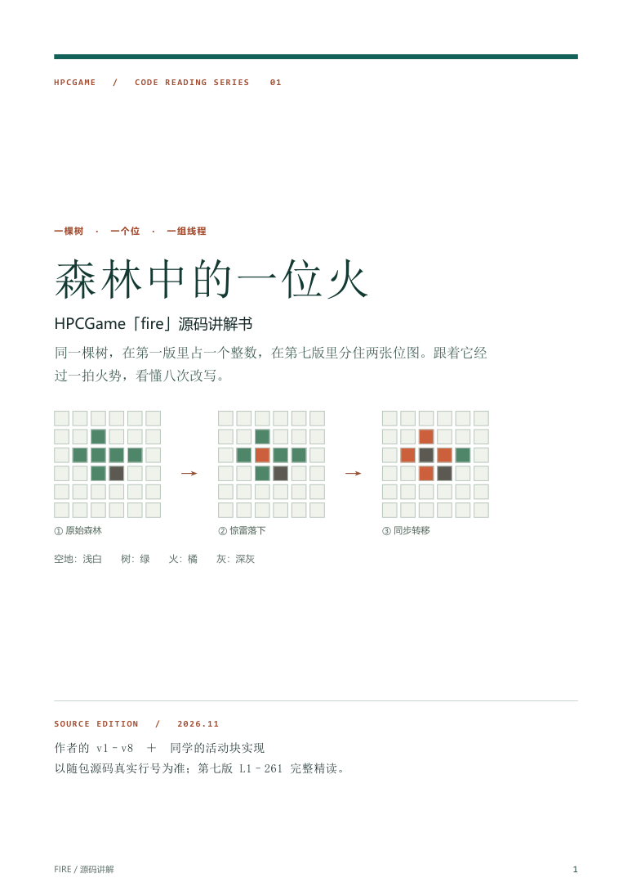
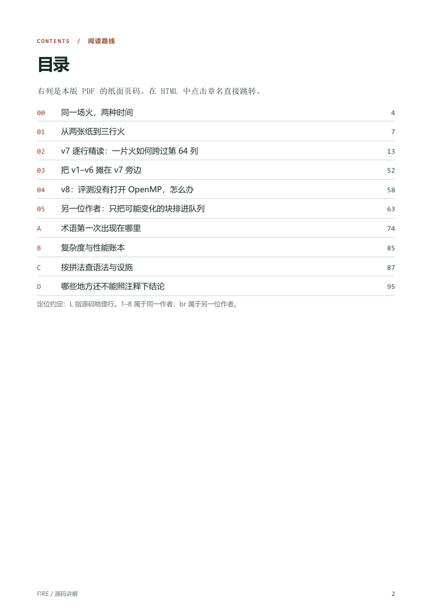

# 自检记录

2026-11-11 · 本记录针对同一版 PDF、HTML 及 Markdown。

- [x] 结构：book 中十个指定章节，加独立阅读导引，共 11 份 Markdown。进度和自检另计。
- [x] 篇幅：PDF 共 96 页；第 2 章为第 13–51 页，共 39 页，占全书 40.625%。
- [x] 以 UTF-8 解码、统一 LF 后按 Unicode 字符计数（等价于同内容的 wc -m）。下表含代码、空白与标记，并非纯中文正文字数。纸本页数在任务预估范围内；按仅数常用汉字的另一口径约 44,208 个，不把代码字符说成中文正文。各章按实际源码展开，没有用估计长度替代实数。

|文件|字符数|
|---|---:|
|00-overview.md|3,332|
|01-evolution.md|9,066|
|02-v7-line-by-line.md|48,912|
|03-compare-1-6.md|9,590|
|04-v8.md|6,404|
|05-br-pool.md|17,805|
|06-appendix-a-glossary.md|17,082|
|07-appendix-b-cost.md|2,387|
|08-appendix-c-index.md|7,404|
|09-appendix-d-issues.md|2,705|
|README.md|424|
|合计|125,111|

- [x] 第 2 章的代码框逐行与原件对比：261/261 行原文相同。逐行解释编号展开后严格等于 1..261，无遗漏、无重复。br 原件为 716 行。

|段|物理行范围|讲解落点|
|---:|---|---|
|1|1–25|时钟与入口|
|2|26–55|读入与游标|
|3|56–84|状态装入|
|4|85–110|事件表|
|5|111–140|分行和惊雷|
|6|141–168|回春及同步|
|7|169–188|窗口初始化|
|8|189–221|转移与发布|
|9|222–261|输出与返回|

- [x] 不仅抽查：其他章节带编号摘录也已逐字核回原文件（383 行次）。以下是用固定种子抽出的五行；行号后的文本在原件和第 2 章相同。

```cpp
193                          uint64_t nbr = L | R | f_prev[j] | f_next[j];
120          std::vector<uint64_t> f_prev(W, 0);
148                              for (int j = j_start; j <= j_end; ++j) {
 70          size_t row_offset = size_t(i) * W;
199                          nb1[idx] = tree;
```

- [x] 术语及语法索引：附录 A 收录 239 项，按正文出现位置排列；附录 C 按拼法检索。交叉检查：omp_get_num_threads → v7 L113（实到人数）；fetch_add → v8 L60（原子到站计数）；__builtin_popcountll → br L450（为选中边段预分配空间）。
- [x] 十一份阅读稿逐字搜索七种禁用套话，命中均为 0。
- [x] 独立逐格核对第 0 章的 36 个输出格；两套编码分别枚举四状态 × 有无邻火；复核八位掩码与窗口例。比对脚本以四组临时文本实查空白、前导零和不对称尾行。没有运行或计时任何参赛程序。
- [x] PDF 已重新打开，A4，96 页都有页码。目录 10 个内部目标均与纸面页码吻合；检查全页文本几何未发现文字跑出页面。人工式图像抽查封面、目录、代码长行、正文批注、词表；长代码在浅色框内换行，行号仍只标原行。HTML 无外置字体、脚本和样式依赖。





[逐行讲解实页](evidence/line-notes.png) · [长代码换行实页](evidence/code-page.png) · [术语表示例](evidence/glossary.png)

- [x] 对照原始 ZIP 逐项计算 SHA-256，17/17 份解压内容逐字节相同。下表列文件指纹，包含十份参讲源文件、题面、参考、脚本与说明。

|材料|SHA-256|
|---|---|
|code/1-fire_pr.cpp|`a0d1b6b2d487fdb93eda3d526c6c9ba29df1e87759c6e5d296581b3ea97b907f`|
|code/2-fire_pr.cpp|`0a776e1d14deb22216b030c7062133f4bf40ae51a407a56dd14418dd6a159c79`|
|code/3-fire_pr.cpp|`39be4e5a3e11bc1fe17b22b5cd89ed2703d0cf418a9549538e6b7409bea81473`|
|code/4-fire_bit.cpp|`a3c6df20cfa44ba34bd8206216c51d6b10c7202d00b9e0a0decbbd2c3c647cc3`|
|code/5-fire_bit.cpp|`78fd3be392eca57ea35713e4c1c11f39867c0f2cee07d2be3d7220af68baac5d`|
|code/6-fire_bit.cpp|`455a5ed4529113582cf32ce64dd5825759937aff89b797d28a16eb44cb291624`|
|code/7-fire_final.cpp|`40ca2b16564a9ba9d4d4cc97703a30e8402051c07b2824fd485dd81833d29905`|
|code/8-fire_final.cpp|`f7cdfbb7a4759cdbcddda5e574f6f09a28c063f507dc3a57de0d4b0ff91642ff`|
|code/br-fire-pool.cpp|`5e0287d6e3c146bd1bcc86d28f2d3d5aeb0449283c50b9d759a1f13515172b5a`|
|code/spin_lock.hpp|`9833a6b9f198c86aa18db3ec3ad375b9f89f235f47b2ec095a7af3bce045f0b9`|
|context/compare.py|`aff4a5d506710aaa6b669e96da6e3e6176176e8aa00d60fa363f4d95999b5933`|
|context/gencase.py|`6e3a44114d011a81e8a3dd0847a902edb2c6b50d1f02da57004f07f7ae51a2b0`|
|context/intro.md|`10ab3dd604bbcf9cd9d78604a52c3c0f110988f692ad4784cc3c17e51e6d712e`|
|context/std-main.cpp|`99aaee1b9126ef570bf1f58ec9f9710e1dc13fbe41c972166f1f0204a9a3588e`|
|style-sample/CppNote.md|`5686a5151be4047b369bf9c4696667a20007919bb94ee422694347c112d6da18`|
|00-READ-ME.txt|`4fb2bc4835cb729510814962b179b0652f7c681966f46208ffdb45901e6203d2`|
|PROMPT.md|`f78e7ac4690a2c451e22fc93140e8b976d4121f47613188c8eedb2c8018fd590`|
